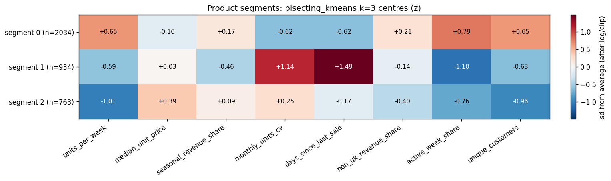
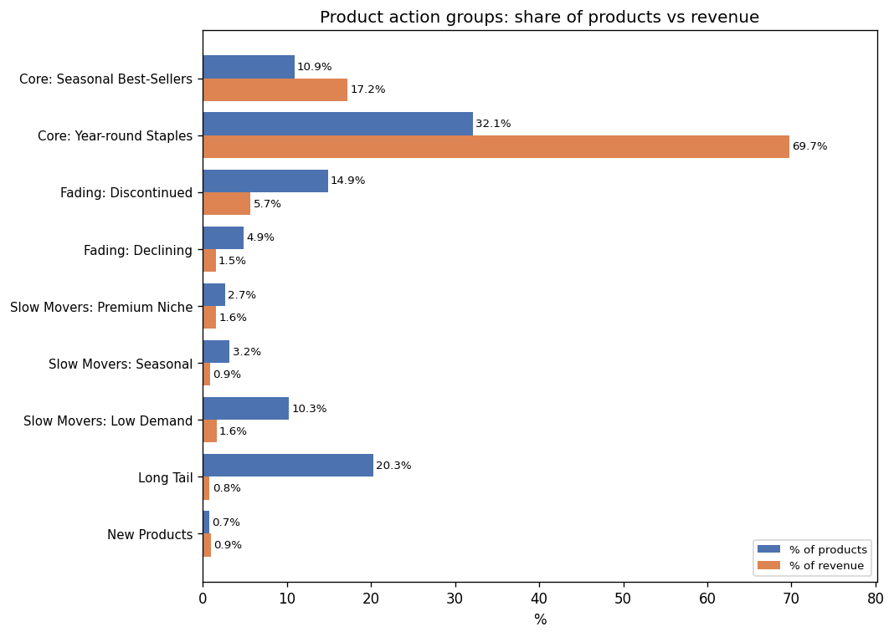
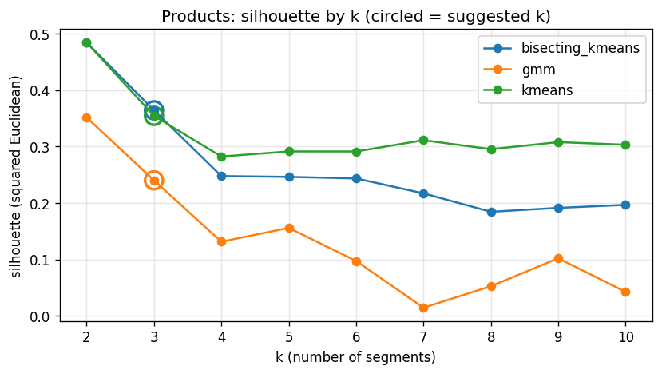
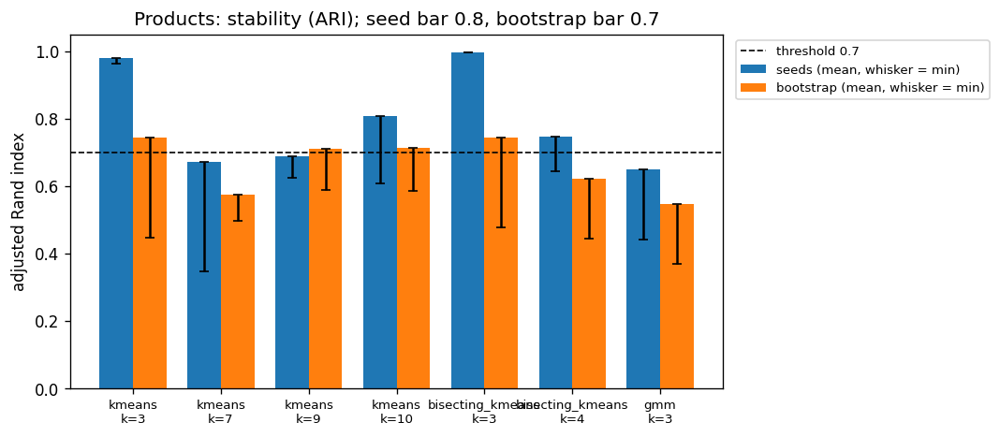
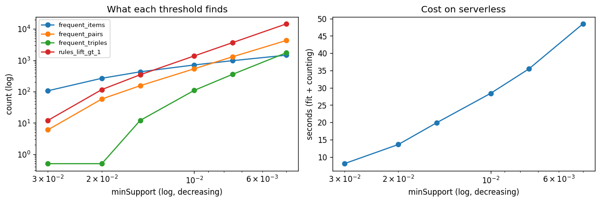

# Product segments and cross-sell insights

Snapshot **2011-12-10** · 4,725 products · generated by `notebooks/04_product_segmentation_mba.py` (section 7) from the real run; do not edit by hand.

## Key insights

1. **Revenue is concentrated in the Core range.** Core Fast Movers are 43.0% of products but 86.9% of revenue; they sell in a median 90.6% of weeks.
2. **A fifth of the catalogue has stopped selling.** Fading Lines are 19.8% of products (median 331 days since the last sale) for 7.2% of revenue: candidates for clearance and delisting.
3. **The long tail is large but worth little.** 20.3% of products had fewer than 20 orders and made 0.8% of revenue.
4. **Customers buy collections.** Of 777 recommendable rules in all baskets, 458 link items of the same range (other designs or companion pieces) and 319 link different products. Colour/design variants (100 rules) were excluded as trivial.
5. **Only 707 products (15.0%) are bought often enough for item-level rules**; the rest need segment-level recommendations (e.g. Core best-sellers).
6. **Markets differ.** 228 rules hold in both the UK and the rest of the world; 1,870 appear only abroad (smaller sample, see caveats).

## How it was built

**Product segmentation**

- **Who is clustered**: 3,731 products with >= 20 invoices and >= 3 months on sale; the rest are rule-based (Long Tail, New Products)
- **Features**: units_per_week, median_unit_price, seasonal_revenue_share, monthly_units_cv, days_since_last_sale, non_uk_revenue_share, active_week_share, unique_customers (log1p: units_per_week, median_unit_price, monthly_units_cv, days_since_last_sale, non_uk_revenue_share, unique_customers; clipped to p1-p99; standardised)
- **Algorithm**: bisecting_kmeans, k = 3 (compared KMeans, bisecting k-means, Gaussian mixture, k = 2-10); silhouette 0.364
- **Stability**: seed ARI 0.997, bootstrap ARI 0.744; agreement with KMeans k = 3: ARI 0.713
- **Selection rule**: pre-stated rule (seed and bootstrap ARI >= 0.8) selected nothing; documented deviation: bootstrap bar 0.7 for products, seed bar kept at 0.8
- **MLflow runs**: preprocessing `bfc59e0523d941e1af94e20bdfba0cb6`, sweep `b37d8caeac6c4d9ea0f13c38321a0c5c`, stability `7fdee340c9ef45d0a2e634f14ada3224`, final model `47f3364bfad44e05862b9f8dd8f35999`
- **Output table**: `retail.gold.product_segments`

**Market basket analysis**

- **Baskets**: 39,516 invoices (median 15 distinct products, p99 196); UK 36,184, rest of world 3,332
- **Algorithm**: Spark ML FP-Growth on serverless (listed as unsupported in the docs; probed and working)
- **Thresholds**: minSupport 0.01 (>= 396 baskets), minConfidence 0.3, recommendable if lift >= 2.0 and not a colour/design variant
- **Why these thresholds**: threshold sweep 0.03-0.005: 0.02 found only 58 pairs, 0.005 found 14.5k rules on ~198 baskets each; 0.01 balances coverage and evidence
- **Independent check**: all 528 single-item rules recomputed with plain Spark joins: 0 unmatched, max lift difference 7.1e-15
- **MLflow runs**: threshold sweep `d859f0327108469a808387b27c5d8ac6`, rules `37226335bd5a468f9bad47bae744c20d`
- **Output table**: `retail.gold.product_associations`

## Product segments

| Segment | Products | Share of products | Share of revenue | Median units/week | Median share of weeks sold | Median price | Median days since last sale | Median Q4 share |
|---|---|---|---|---|---|---|---|---|
| Core Fast Movers | 2,034 | 43.0% | 86.9% | 33.8 | 90.6% | £1.65 | 2 | 34.4% |
| Fading Lines | 934 | 19.8% | 7.2% | 4.8 | 26.4% | £2.10 | 331 | 19.2% |
| Slow Movers | 763 | 16.1% | 4.1% | 2.5 | 39.6% | £2.95 | 5 | 36.3% |
| Long Tail | 959 | 20.3% | 0.8% | 0.3 | 6.6% | £2.90 | 410 | 34.7% |
| New Products | 35 | 0.7% | 0.9% | 20.0 | 100.0% | £2.08 | 2 | 100.0% |

- **Core Fast Movers**: Sell almost every week to many customers: the range that makes most of the revenue.
- **Fading Lines**: Mostly not sold for months: discontinued or dying lines, sold in bursts while active.
- **Slow Movers**: Still on sale but low demand: a few units a week, few customers, higher-priced and UK-centric.
- **New Products**: Give launch visibility (homepage, new-in email); review after 3 months of sales
- **Long Tail**: Keep online only if cheap to hold; candidates for clearance or delisting; bundle with best-sellers

## Action groups and recommended actions

| Segment | Action group | Products | Share of revenue | Recommended action | KPI |
|---|---|---|---|---|---|
| Core Fast Movers | Core: Seasonal Best-Sellers | 515 | 17.2% | Stock up before Q4 (order by August), feature in the Christmas catalogue and gift guides; anchor seasonal cross-sell bundles. | Q4 stock-outs; Q4 revenue vs last year; sell-through by mid-December. |
| Core Fast Movers | Core: Year-round Staples | 1,519 | 69.7% | Never out of stock: safety stock and automatic replenishment; volume-tier pricing for wholesale buyers; use as cross-sell anchors (Phase 4 rules). | Availability (in-stock rate); units per week; attach rate of cross-sells. |
| Fading Lines | Fading: Discontinued | 703 | 5.7% | Confirm delisting, clear remaining stock (clearance bundles), remove from the website and catalogue; suggest the closest active alternative. | Stock cleared; holding cost released. |
| Fading Lines | Fading: Declining | 231 | 1.5% | Decide keep or delist: check margin and whether sales are a one-off burst; if kept, promote with a Core product; otherwise run down stock. | Units per week over the next quarter; margin per unit. |
| Slow Movers | Slow Movers: Premium Niche | 126 | 1.6% | Keep as a curated premium range with low stock depth (or made to order); show next to related best-sellers; targeted to high-value customers. | Revenue per product; stock days of cover; margin. |
| Slow Movers | Slow Movers: Seasonal | 152 | 0.9% | Buy shallow for Q4 only and promote within the season; no year-round stock. | Q4 sell-through; leftover stock in January. |
| Slow Movers | Slow Movers: Low Demand | 485 | 1.6% | Review the range: reduce stock depth, bundle with Core products, or replace with a better-selling variant. | Units per week; stock days of cover. |
| Long Tail | Long Tail | 959 | 0.8% | Keep online only if cheap to hold; candidates for clearance or delisting; bundle with best-sellers | Revenue per listed product; delisted count. |
| New Products | New Products | 35 | 0.9% | Give launch visibility (homepage, new-in email); review after 3 months of sales | Units per week in the first 3 months; repeat orders. |

## Association rules

| Scope | Rule type | Rules | Recommendable | Median lift | Median confidence |
|---|---|---|---|---|---|
| UK | complementary | 376 | 376 | 7.68 | 41.4% |
| UK | similar | 495 | 495 | 10.18 | 54.1% |
| UK | variant | 98 | 0 | 18.73 | 58.0% |
| all | complementary | 319 | 319 | 8.25 | 41.1% |
| all | similar | 458 | 458 | 10.03 | 53.1% |
| all | variant | 100 | 0 | 19.04 | 57.9% |
| rest | complementary | 1,459 | 1,456 | 13.56 | 63.6% |
| rest | similar | 642 | 642 | 8.30 | 58.3% |
| rest | variant | 389 | 0 | 24.03 | 83.0% |

### Cross-sell: different products bought together

Product-page recommendations across product types (rule type *complementary*, one rule per pair, by lift).

| If the basket has | Recommend | Support | Confidence | Lift | Orders |
|---|---|---|---|---|---|
| KEY FOB , BACK DOOR | KEY FOB , GARAGE DESIGN | 1.0% | 58.4% | 37.1 | 402 |
| KEY FOB , SHED | KEY FOB , BACK DOOR | 1.2% | 57.6% | 33.1 | 481 |
| GARDENERS KNEELING PAD CUP OF TEA | GARDENERS KNEELING PAD KEEP CALM | 1.4% | 72.0% | 31.2 | 546 |
| RED RETROSPOT PLATE | RED RETROSPOT CUP | 1.1% | 63.2% | 27.6 | 415 |
| BLUE POLKADOT CUP | RED RETROSPOT CUP | 1.2% | 61.5% | 26.9 | 473 |
| PINK POLKADOT CUP | RED RETROSPOT CUP | 1.1% | 59.5% | 26.0 | 447 |
| RED RETROSPOT BOWL | BLUE POLKADOT BOWL | 1.1% | 43.9% | 25.0 | 424 |
| RED RETROSPOT SUGAR JAM BOWL | RED RETROSPOT SMALL MILK JUG | 1.3% | 64.7% | 23.0 | 502 |
| HAND WARMER SCOTTY DOG DESIGN | HAND WARMER OWL DESIGN | 1.6% | 59.9% | 19.5 | 649 |
| HAND WARMER BIRD DESIGN | HAND WARMER SCOTTY DOG DESIGN | 1.4% | 52.7% | 19.2 | 555 |

Recommendations:

- Basket has **KEY FOB , BACK DOOR** → suggest **KEY FOB , GARAGE DESIGN**: already in 58.4% of those baskets, 37.1× more likely than in an average basket (402 orders).
- Basket has **KEY FOB , SHED** → suggest **KEY FOB , BACK DOOR**: already in 57.6% of those baskets, 33.1× more likely than in an average basket (481 orders).
- Basket has **GARDENERS KNEELING PAD CUP OF TEA** → suggest **GARDENERS KNEELING PAD KEEP CALM**: already in 72.0% of those baskets, 31.2× more likely than in an average basket (546 orders).
- Basket has **RED RETROSPOT PLATE** → suggest **RED RETROSPOT CUP**: already in 63.2% of those baskets, 27.6× more likely than in an average basket (415 orders).
- Basket has **BLUE POLKADOT CUP** → suggest **RED RETROSPOT CUP**: already in 61.5% of those baskets, 26.9× more likely than in an average basket (473 orders).

### Complete the collection

Same range, other design or companion piece (rule type *similar*, one rule per pair, by confidence): show the rest of the range next to the item.

| If the basket has | Recommend | Support | Confidence | Lift | Orders |
|---|---|---|---|---|---|
| POPPY'S PLAYHOUSE LIVINGROOM | POPPY'S PLAYHOUSE KITCHEN | 1.2% | 84.0% | 44.8 | 474 |
| POPPY'S PLAYHOUSE BEDROOM | POPPY'S PLAYHOUSE KITCHEN | 1.4% | 79.2% | 42.2 | 557 |
| WOODEN TREE CHRISTMAS SCANDINAVIAN | WOODEN STAR CHRISTMAS SCANDINAVIAN | 1.1% | 79.0% | 40.7 | 437 |
| PINK REGENCY TEACUP AND SAUCER | ROSES REGENCY TEACUP AND SAUCER | 2.1% | 78.6% | 21.8 | 812 |
| SET/10 BLUE SPOTTY PARTY CANDLES | SET/10 PINK POLKADOT PARTY CANDLES | 1.2% | 77.6% | 38.0 | 488 |
| SET/6 RED SPOTTY PAPER CUPS | SET/6 RED SPOTTY PAPER PLATES | 1.6% | 77.2% | 31.0 | 651 |
| GREEN REGENCY TEACUP AND SAUCER | ROSES REGENCY TEACUP AND SAUCER | 2.6% | 76.4% | 21.2 | 1,034 |
| KEY FOB , GARAGE DESIGN | KEY FOB , SHED | 1.2% | 75.1% | 35.5 | 467 |
| SWEETHEART CERAMIC TRINKET BOX | STRAWBERRY CERAMIC TRINKET BOX | 2.8% | 74.8% | 12.1 | 1,109 |
| TOILET METAL SIGN | BATHROOM METAL SIGN | 1.7% | 72.5% | 21.4 | 662 |

Recommendations:

- Basket has **POPPY'S PLAYHOUSE LIVINGROOM** → suggest **POPPY'S PLAYHOUSE KITCHEN**: already in 84.0% of those baskets, 44.8× more likely than in an average basket (474 orders).
- Basket has **POPPY'S PLAYHOUSE BEDROOM** → suggest **POPPY'S PLAYHOUSE KITCHEN**: already in 79.2% of those baskets, 42.2× more likely than in an average basket (557 orders).
- Basket has **WOODEN TREE CHRISTMAS SCANDINAVIAN** → suggest **WOODEN STAR CHRISTMAS SCANDINAVIAN**: already in 79.0% of those baskets, 40.7× more likely than in an average basket (437 orders).
- Basket has **PINK REGENCY TEACUP AND SAUCER** → suggest **ROSES REGENCY TEACUP AND SAUCER**: already in 78.6% of those baskets, 21.8× more likely than in an average basket (812 orders).
- Basket has **SET/10 BLUE SPOTTY PARTY CANDLES** → suggest **SET/10 PINK POLKADOT PARTY CANDLES**: already in 77.6% of those baskets, 38.0× more likely than in an average basket (488 orders).

### Basket completion

Two or more items already in the basket (by confidence): checkout prompts.

| If the basket has | Recommend | Support | Confidence | Lift | Orders |
|---|---|---|---|---|---|
| STRAWBERRY CHARLOTTE BAG + WOODLAND CHARLOTTE BAG + CHARLOTTE BAG PINK POLKADOT | RED RETROSPOT CHARLOTTE BAG | 1.1% | 90.4% | 17.6 | 423 |
| STRAWBERRY CHARLOTTE BAG + CHARLOTTE BAG PINK POLKADOT + CHARLOTTE BAG SUKI DESIGN | RED RETROSPOT CHARLOTTE BAG | 1.1% | 88.8% | 17.2 | 445 |
| POPPY'S PLAYHOUSE LIVINGROOM + POPPY'S PLAYHOUSE BEDROOM | POPPY'S PLAYHOUSE KITCHEN | 1.0% | 88.7% | 47.2 | 409 |
| SET/6 RED SPOTTY PAPER CUPS + SET/20 RED RETROSPOT PAPER NAPKINS | SET/6 RED SPOTTY PAPER PLATES | 1.2% | 87.1% | 35.0 | 485 |
| PINK REGENCY TEACUP AND SAUCER + GREEN REGENCY TEACUP AND SAUCER + REGENCY CAKESTAND 3 TIER | ROSES REGENCY TEACUP AND SAUCER | 1.1% | 87.1% | 24.2 | 431 |
| PINK REGENCY TEACUP AND SAUCER + GREEN REGENCY TEACUP AND SAUCER | ROSES REGENCY TEACUP AND SAUCER | 1.9% | 85.1% | 23.6 | 735 |
| WOODLAND CHARLOTTE BAG + CHARLOTTE BAG PINK POLKADOT + CHARLOTTE BAG SUKI DESIGN | RED RETROSPOT CHARLOTTE BAG | 1.1% | 84.9% | 16.5 | 454 |
| STRAWBERRY CHARLOTTE BAG + WOODLAND CHARLOTTE BAG + CHARLOTTE BAG SUKI DESIGN | RED RETROSPOT CHARLOTTE BAG | 1.1% | 84.8% | 16.5 | 429 |

Recommendations:

- Basket has **STRAWBERRY CHARLOTTE BAG + WOODLAND CHARLOTTE BAG + CHARLOTTE BAG PINK POLKADOT** → suggest **RED RETROSPOT CHARLOTTE BAG**: already in 90.4% of those baskets, 17.6× more likely than in an average basket (423 orders).
- Basket has **STRAWBERRY CHARLOTTE BAG + CHARLOTTE BAG PINK POLKADOT + CHARLOTTE BAG SUKI DESIGN** → suggest **RED RETROSPOT CHARLOTTE BAG**: already in 88.8% of those baskets, 17.2× more likely than in an average basket (445 orders).
- Basket has **POPPY'S PLAYHOUSE LIVINGROOM + POPPY'S PLAYHOUSE BEDROOM** → suggest **POPPY'S PLAYHOUSE KITCHEN**: already in 88.7% of those baskets, 47.2× more likely than in an average basket (409 orders).
- Basket has **SET/6 RED SPOTTY PAPER CUPS + SET/20 RED RETROSPOT PAPER NAPKINS** → suggest **SET/6 RED SPOTTY PAPER PLATES**: already in 87.1% of those baskets, 35.0× more likely than in an average basket (485 orders).
- Basket has **PINK REGENCY TEACUP AND SAUCER + GREEN REGENCY TEACUP AND SAUCER + REGENCY CAKESTAND 3 TIER** → suggest **ROSES REGENCY TEACUP AND SAUCER**: already in 87.1% of those baskets, 24.2× more likely than in an average basket (431 orders).

### Rest of the world only

Rules mined in non-UK baskets that don't hold in the UK (by lift); each rests on a small number of orders, so test before rolling out.

| If the basket has | Recommend | Support | Confidence | Lift | Orders |
|---|---|---|---|---|---|
| DOLLY GIRL CHILDRENS CUP + SPACEBOY CHILDRENS BOWL | DOLLY GIRL CHILDRENS BOWL | 1.2% | 100.0% | 62.9 | 41 |
| DOLLY GIRL CHILDRENS CUP + SPACEBOY CHILDRENS CUP + SPACEBOY CHILDRENS BOWL | DOLLY GIRL CHILDRENS BOWL | 1.1% | 100.0% | 62.9 | 37 |
| DOLLY GIRL CHILDRENS BOWL + SPACEBOY CHILDRENS CUP | DOLLY GIRL CHILDRENS CUP | 1.1% | 100.0% | 61.7 | 38 |
| DOLLY GIRL CHILDRENS BOWL | DOLLY GIRL CHILDRENS CUP | 1.4% | 88.7% | 54.7 | 47 |
| SPACEBOY BABY GIFT SET | DOLLY GIRL BABY GIFT SET | 1.0% | 68.0% | 51.5 | 34 |
| POPPY'S PLAYHOUSE LIVINGROOM + POPPY'S PLAYHOUSE BEDROOM + POPPY'S PLAYHOUSE KITCHEN | POPPY'S PLAYHOUSE BATHROOM | 1.1% | 67.3% | 48.7 | 37 |
| BOYS VINTAGE TIN SEASIDE BUCKET | GIRLS VINTAGE TIN SEASIDE BUCKET | 1.4% | 86.5% | 48.1 | 45 |
| POPPY'S PLAYHOUSE LIVINGROOM + POPPY'S PLAYHOUSE BEDROOM | POPPY'S PLAYHOUSE BATHROOM | 1.1% | 64.4% | 46.7 | 38 |

Recommendations:

- Basket has **DOLLY GIRL CHILDRENS CUP + SPACEBOY CHILDRENS BOWL** → suggest **DOLLY GIRL CHILDRENS BOWL**: already in 100.0% of those baskets, 62.9× more likely than in an average basket (41 orders).
- Basket has **DOLLY GIRL CHILDRENS CUP + SPACEBOY CHILDRENS CUP + SPACEBOY CHILDRENS BOWL** → suggest **DOLLY GIRL CHILDRENS BOWL**: already in 100.0% of those baskets, 62.9× more likely than in an average basket (37 orders).
- Basket has **DOLLY GIRL CHILDRENS BOWL + SPACEBOY CHILDRENS CUP** → suggest **DOLLY GIRL CHILDRENS CUP**: already in 100.0% of those baskets, 61.7× more likely than in an average basket (38 orders).
- Basket has **DOLLY GIRL CHILDRENS BOWL** → suggest **DOLLY GIRL CHILDRENS CUP**: already in 88.7% of those baskets, 54.7× more likely than in an average basket (47 orders).
- Basket has **SPACEBOY BABY GIFT SET** → suggest **DOLLY GIRL BABY GIFT SET**: already in 68.0% of those baskets, 51.5× more likely than in an average basket (34 orders).

## Caveats

- Revenue is gross (before returns). One New Products item (23843, paper craft little birdie) is a single 80,995-unit order that was fully returned, so New Products revenue is overstated.
- Q4 share: a product sold evenly over the whole period has ~25 % of its revenue in Q4 (Dec 2009 + two Q4s), so 'seasonal' means > 50 %.
- Product clusters are less separated than customer segments; the bootstrap stability bar was lowered after seeing the data (recorded as a deviation in MLflow).
- Rule types come from stock-code families and description words; the data has no category hierarchy, so a few same-range items are labelled complementary (e.g. key fobs).
- Rest-of-world rules rest on as few as 34 baskets; test them before rolling out.
- Rules describe co-purchase, not cause: validate recommendations with an A/B test (attach rate, basket value).
- Many customers are wholesale buyers who stock whole ranges, which explains very high lifts inside collections.

