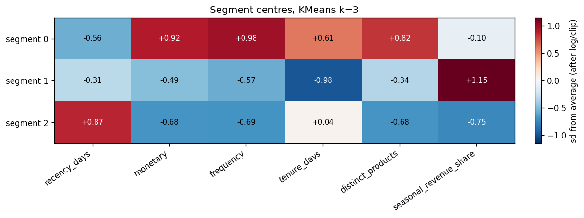
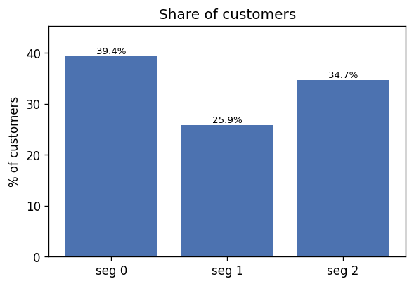
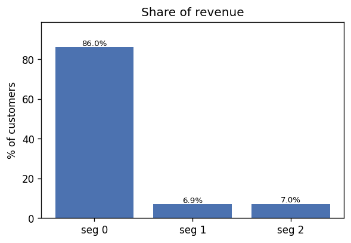
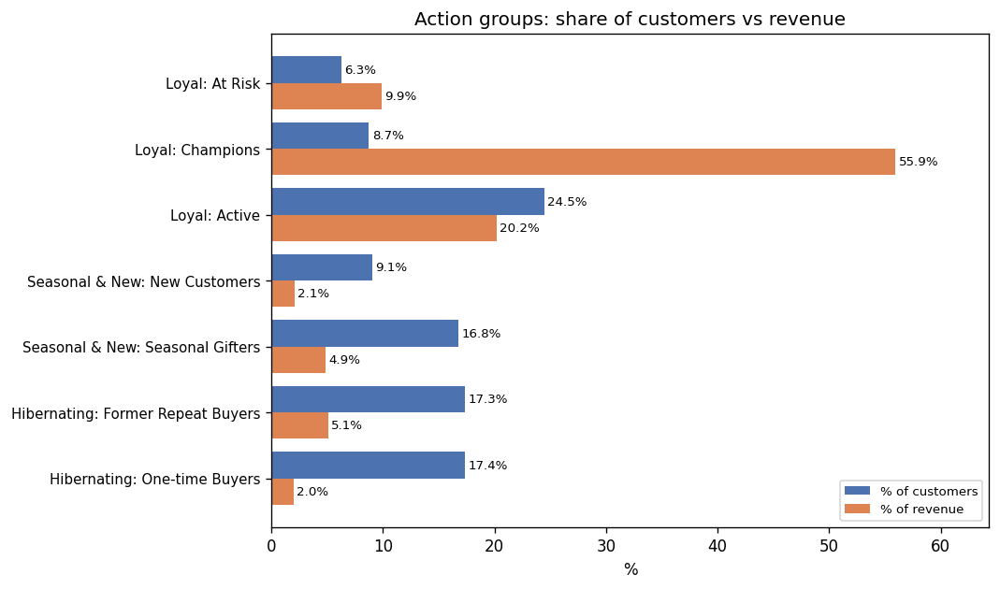
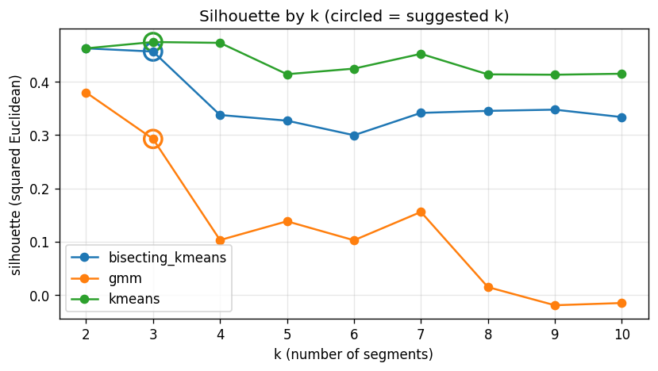
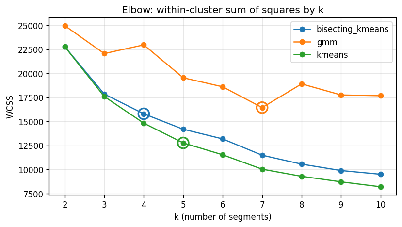
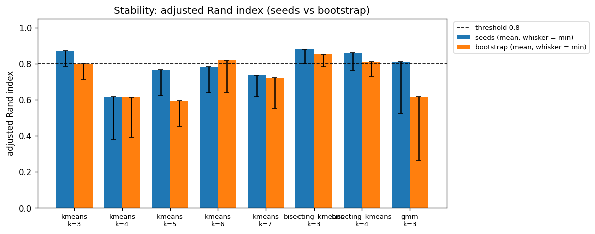

# Customer segment profiles

Snapshot **2011-12-10** · 5,852 customers with a customer id · generated by `notebooks/03_customer_segmentation.py` (section 7) from the real run; do not edit by hand.

## How the segments were built

- **Features**: 5,852 customers, snapshot 2011-12-10; clustered on recency_days, monetary, frequency, tenure_days, distinct_products, seasonal_revenue_share (log1p: monetary, frequency, distinct_products; clipped to p1-p99; standardised)
- **Algorithm**: KMeans, k = 3, seed 42 (compared with bisecting k-means and Gaussian mixture, k = 2-10)
- **Why k = 3**: best silhouette (0.474); k = 4 tied on silhouette but was unstable
- **Stability**: mean ARI across seeds 0.871, across bootstrap samples 0.801; agreement with bisecting k-means (k = 3) ARI 0.590
- **MLflow runs**: preprocessing `5f3511af13b548bba0051eda67015195`, sweep `6fc3f33df1ff4880927d01f3faf92071`, stability `fd5c99e7c17742f6a2745ef2d479b270`, final model `cde7c22478fc4656a76f6d458e7137e3`
- **Output table**: `retail.gold.customer_segments`

## The segments

| | Loyal Customers | Seasonal & New | Hibernating |
|---|---|---|---|
| Customers | 2,308 | 1,513 | 2,031 |
| Share of customers | 39.4% | 25.9% | 34.7% |
| Share of revenue | 86.0% | 6.9% | 7.0% |
| Revenue per customer | £6,362 | £783 | £591 |
| Median days since last order | 37 | 45 | 396 |
| Median orders | 8 | 2 | 1 |
| Median spend | £2,796 | £490 | £364 |
| Median basket value | £331 | £248 | £222 |
| Median distinct products | 118 | 30 | 20 |
| Median tenure (days) | 654 | 281 | 541 |
| Median days between orders (repeat buyers) | 71.9 | 79.7 | 107.0 |
| Median Q4 share of spend | 34.0% | 100.0% | 0.0% |
| Bought only once | 0.0% | 39.7% | 50.1% |
| Bought in the last 90 days | 73.6% | 68.3% | 7.5% |
| First bought in the last 90 days | 0.1% | 35.0% | 3.1% |
| Returned something | 68.1% | 24.1% | 23.9% |
| UK customers | 91.1% | 90.3% | 91.8% |

- **Loyal Customers** (segment 0): Recent, frequent, broad buyers with long tenure: the revenue base.
- **Seasonal & New** (segment 1): Spend concentrated in Oct-Dec: new customers acquired in Q4 2011 and gift-season-only buyers.
- **Hibernating** (segment 2): Last order about a year ago or more, mostly one or two orders.

## Action groups and recommended actions

Rule-based groups inside each segment (definitions in `src/segmentation/naming.py`): *overdue* = repeat buyer whose time since the last order is more than twice their own average gap; *new* = first order in the last 90 days; *top value* = top 10% by spend.

| Action group | Customers | Share of customers | Share of revenue | Median days since last order | Median spend | Recommended action | KPI |
|---|---|---|---|---|---|---|---|
| Loyal: At Risk | 366 | 6.3% | 9.9% | 276 | £2,163 | Personal win-back before they lapse: account call/email from a named contact, reminder of their usual products, time-limited loyalty discount. | Share placing an order within 60 days; revenue recovered. |
| Loyal: Champions | 511 | 8.7% | 55.9% | 13 | £9,070 | Retain and grow: VIP tier, early access to new ranges and the Christmas catalogue, referral programme, no blanket discounts (they buy anyway). | Retention rate; revenue per customer; referrals. |
| Loyal: Active | 1,431 | 24.5% | 20.2% | 34 | £2,181 | Grow basket and frequency: cross-sell from Phase 4 association rules, volume-tier pricing, replenishment reminders at their usual interval. | Orders per customer; average basket value; distinct products. |
| Seasonal & New: New Customers | 530 | 9.1% | 2.1% | 25 | £396 | Onboarding journey: welcome series, best-sellers, second-order incentive within 30-45 days so they become repeat buyers outside Q4. | Second-order rate within 90 days (Phase 5 propensity target). |
| Seasonal & New: Seasonal Gifters | 983 | 16.8% | 4.9% | 74 | £534 | Seasonal calendar: pre-season reminders in September/October, gift guides, plus off-season occasions (Valentine's, Easter, Mother's Day) to spread demand. | Share buying outside Q4; Q4 repeat rate. |
| Hibernating: Former Repeat Buyers | 1,014 | 17.3% | 5.1% | 363 | £612 | Low-cost reactivation: 'we miss you' email with an offer on previously bought categories; ask why they left; stop if no response. | Reactivation rate; cost per reactivated customer. |
| Hibernating: One-time Buyers | 1,017 | 17.4% | 2.0% | 481 | £217 | Lowest priority: include in seasonal newsletters only, then suppress to cut marketing cost and keep the list clean. | Reactivation rate vs mailing cost; unsubscribe rate. |

## Caveats

- Seasonal share is confounded with newness: customers acquired in Q4 2011 have only Q4 history. The *New Customers* / *Seasonal Gifters* split separates them.
- Tenure is censored for customers first seen in Dec 2009 (the first month of data).
- k = 3 was chosen for stability; finer clusterings (k = 4) changed with the random seed, so finer targeting uses the transparent rules above instead.
